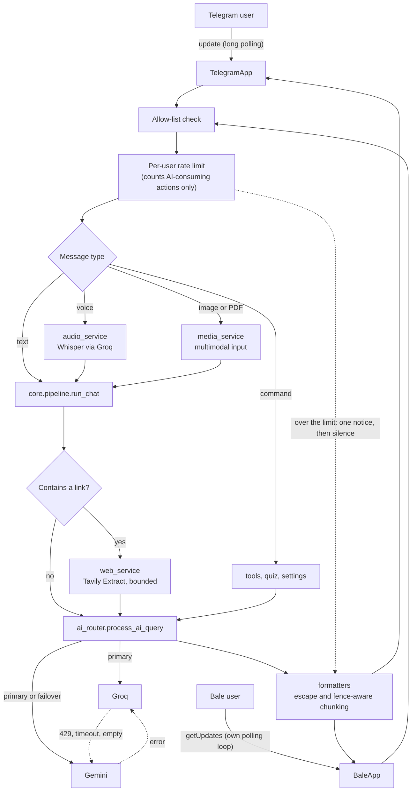

<div align="center">


<br/>

[](https://github.com/mahdi-barzegar-nazari/resilient-ai-gateway/actions/workflows/ci.yml)
[](./LICENSE)
[](./requirements.txt)
[](./Dockerfile)
[](./bot)
[](./CONTRIBUTING.md)

**دستیار هوش مصنوعی تلگرام + بله که حتی وقتی یک سرویس‌دهنده از کار بیفتد، پاسخ‌دادن را ادامه می‌دهد.**
سوییچ خودکار Groq ⇄ Gemini · درک ویس، عکس، PDF و لینک · جعبه‌ابزار دانشجویی

**[🇬🇧 English](./README.md)** · **[یادداشت‌های معماری](./docs/architecture.md)**

</div>

---

## نمای کلی

یک دستیار هوش مصنوعی **چندسکویی (تلگرام + بله)** که حتی وقتی یکی از سرویس‌دهنده‌ها از کار بیفتد، به پاسخ‌دادن ادامه می‌دهد: **سوییچ خودکار Groq ⇄ Gemini**، درک ویس، عکس، PDF و لینک، و یک جعبه‌ابزار دانشجویی (کمک به دیباگ، پل ویکی‌پدیا و ArXiv، آزمون‌ساز).

معماری آن یک **دروازه‌ی مرز شبکه** است: کاربرِ پشت اینترنت داخلی با یک پیام‌رسان داخلی حرف می‌زند و سرور، که بیرون از مرز اجرا می‌شود، به‌جای او به APIها و سایت‌های بین‌المللی وصل می‌شود.

کد لایه‌بندی شده است (`bot ← core ← services ← utils`)، هر رفتار فهرست‌شده در این سند با یک تست رگرسیون آفلاین ثابت نگه داشته می‌شود و کل ۴۵۹ تست در کمتر از یک ثانیه و بدون هیچ کلید API اجرا می‌شود.

## ویژگی‌ها

- **یک مغز، دو پیام‌رسان.** تلگرام (با pyTelegramBotAPI) و بله (کلاینت پولینگ دست‌نویس) از یک پایپ‌لاین مشترک استفاده می‌کنند؛ هر اصلاح روی هر دو اعمال می‌شود.
- **سوییچ خودکار سرویس‌دهنده.** خطای ۴۲۹، تایم‌اوت یا پاسخ خالی از Groq ⇒ همان درخواست روی Gemini تکرار می‌شود (و برعکس) و یک یادداشت کوتاه به پاسخ اضافه می‌شود.
- **چند کلید API برای هر سرویس‌دهنده.** متغیرهای `GROQ_API_KEYS`، `GEMINI_API_KEYS` و `TAVILY_API_KEYS` چند کلید جداشده با کاما می‌پذیرند؛ درخواست‌ها به‌نوبت بین کلیدها پخش می‌شوند و کلیدی که به محدودیت نرخ، تایم‌اوت یا خطا بخورد برای مدتی کنار گذاشته می‌شود. با یک کلید، رفتار دقیقاً مثل قبل است.
- **سقف درخواست برای هر کاربر.** هر کاربر در هر ۶۰ ثانیه می‌تواند حداکثر ۲۰ درخواستِ سهمیه‌خور بفرستد (`RATE_LIMIT_MAX` و `RATE_LIMIT_WINDOW_SECONDS`؛ مقدار `0` سقف را خاموش می‌کند). شمارش برای تلگرام و بله جداست. به کاربری که از سقف رد شود فقط یک پیام کوتاه با تعداد ثانیه‌های انتظار داده می‌شود و دستورهای بی‌هزینه اصلاً شمرده نمی‌شوند.
- **ورودی چندوجهی.** ویس (Whisper)، عکس و PDF (Gemini)، لینک (Tavily Extract).
- **خروجی امن برای پیام‌رسان.** شکستن پیام با حفظ بلاک‌های کد، فرار کاراکترهای HTML و بازگشت به متن ساده.
- **پیش‌فرض‌های حریم‌خصوصی.** حافظه‌ی گفتگو تا وقتی کاربر روشنش نکند **خاموش** است و کلیدها از همه‌ی لاگ‌ها حذف می‌شوند.
- **تست بدون اینترنت.** ۴۵۹ تست واحد در کمتر از یک ثانیه و بدون هیچ کلید API اجرا می‌شوند.

### جدول قابلیت‌ها

| قابلیت | تلگرام | بله | موتور |
|---|:---:|:---:|---|
| گفتگوی متنی و تعویض مدل (`/fast` `/smart` `/gemini`) | ✅ | ✅ | Groq (Qwen / GPT-OSS-120B) · Gemini |
| سوییچ خودکار سرویس‌دهنده | ✅ | ✅ | `services/ai_router.py` |
| ویس ← متن ← پاسخ | ✅ | ✅ | Whisper روی Groq |
| تحلیل عکس | ✅ | ✅ | Gemini |
| خواندن PDF، خلاصه و حل تمرین | ✅ | ✅ | Gemini (ورودی مستقیم `application/pdf`) |
| خلاصه‌سازی لینک (فقط URL بفرستید) | ✅ | ✅ | Tavily Extract + مدل |
| داده‌ی زنده‌ی وب برای سؤال‌های تازه | ✅ | ✅ | Tavily Search ← Google News RSS |
| `/read` `/wiki` `/arxiv` `/arxiv_full` | ✅ | ✅ | Tavily · API ویکی‌پدیا · API ArXiv |
| `/debug` (خطا ← ریشه‌ی باگ ← کد اصلاح‌شده) | ✅ | ✅ | پرامپت اختصاصی + خروجی بلند |
| `/quiz` آزمون چهارگزینه‌ای با سختی تطبیقی | ✅ دکمه یا تایپ | ✅ تایپ | مدل با قرارداد JSON سخت‌گیرانه |
| حالت آزمون (خروجی تک‌سطری پاسخ‌نامه) | ✅ | ✅ | پرامپت اختصاصی + دمای پایین |
| پنل دکمه‌ای (Inline Keyboard) | ✅ | — | فقط تلگرام |
| محدودیت دسترسی با فهرست مجاز | ✅ | ✅ | `ALLOWED_USERS` |
| سقف درخواست برای هر کاربر (پنجره‌ی لغزان) | ✅ | ✅ | `core/ratelimit.py` |

## شروع سریع

### اجرای محلی

```bash
git clone https://github.com/mahdi-barzegar-nazari/resilient-ai-gateway.git
cd resilient-ai-gateway
python -m venv .venv && source .venv/bin/activate
pip install -r requirements.txt

cp .env.example .env        # کلیدها را پر کنید؛ .env توسط git نادیده گرفته می‌شود
set -a && source .env && set +a
python main.py
```

حداقل به یک توکن بات (`TELEGRAM_BOT_TOKEN` از @BotFather یا `BALE_BOT_TOKEN` از BotFather بله) و یک کلید هوش مصنوعی
(`GROQ_API_KEY` و/یا `GEMINI_API_KEY`) نیاز دارید. برای فعال شدن سوییچ خودکار هر دو کلید را بگذارید.
هر سرویس‌دهنده چند کلید هم می‌پذیرد (`GROQ_API_KEYS`، `GEMINI_API_KEYS` و `TAVILY_API_KEYS`؛ جدول زیر را ببینید).

### تنظیمات

| متغیر | الزامی | کاربرد |
|---|:---:|---|
| `TELEGRAM_BOT_TOKEN` / `BALE_BOT_TOKEN` | یکی از دو | اعتبارنامه‌ی بات. اگر فقط یکی تنظیم شود فقط همان پلتفرم اجرا می‌شود. |
| `GROQ_API_KEY` | یکی از دو کلید AI | مدل‌های متنی و Whisper |
| `GEMINI_API_KEY` | یکی از دو کلید AI | مدل جایگزین، **عکس و PDF** |
| `TAVILY_API_KEY` | اختیاری | جستجوی وب، خلاصه‌ی لینک، `/read` |
| `GROQ_API_KEYS` `GEMINI_API_KEYS` `TAVILY_API_KEYS` | اختیاری | کلیدهای اضافه، جداشده با کاما؛ با متغیرهای تکیِ بالا ادغام می‌شوند (فاصله و آیتم خالی نادیده گرفته می‌شود و تکراری‌ها حذف می‌شوند). با دو کلید یا بیشتر برای یک سرویس‌دهنده، درخواست‌ها به‌نوبت چرخانده می‌شوند. |
| `KEY_MAX_ATTEMPTS` `KEY_RETRY_BUDGET_SECONDS` | اختیاری | سقف چرخش: تعداد کلیدهایی که برای هر درخواست امتحان می‌شود (پیش‌فرض ۳) و زمانی که پس از آن دیگر کلید تازه‌ای امتحان نمی‌شود (پیش‌فرض ۹۰ ثانیه) |
| `KEY_COOLDOWN_RATE_LIMIT` `KEY_COOLDOWN_RATE_LIMIT_MAX` `KEY_COOLDOWN_TRANSIENT` `KEY_COOLDOWN_AUTH` | اختیاری | ثانیه‌هایی که کلید کنار گذاشته می‌شود: پس از ۴۲۹ بدون `Retry-After` (۶۰)، سقف `Retry-After` (۳۰۰)، تایم‌اوت، قطع اتصال یا خطای ۵xx (۱۵)، و ۴۰۱/۴۰۳ (۳۶۰۰) |
| `ALLOWED_USERS` | توصیه‌شده | شناسه‌های عددی با کاما؛ خالی = همه می‌توانند استفاده کنند |
| `RATE_LIMIT_MAX` `RATE_LIMIT_WINDOW_SECONDS` | اختیاری | سقف درخواست‌های سهمیه‌خور برای هر کاربر در هر پنجره‌ی زمانی که برای تلگرام و بله جداگانه شمرده می‌شود (پیش‌فرض: ۲۰ درخواست در ۶۰ ثانیه). `RATE_LIMIT_MAX=0` سقف را کاملاً خاموش می‌کند. |
| `MODEL_FAST` `MODEL_SMART` `MODEL_GEMINI` `MODEL_WHISPER` | اختیاری | جایگزینی نام مدل‌های پیش‌فرض |
| `WHISPER_LANGUAGE` | اختیاری | پیش‌فرض `fa`؛ رشته‌ی خالی = تشخیص خودکار |
| `PORT` | اختیاری | پورت سرور سلامت (پیش‌فرض ۸۰۸۰) |

### استقرار

- **Render:** فایل `render.yaml` یک Blueprint است (سرویس وب رایگان با مسیر سلامت `/healthz`). کلیدها را در داشبورد وارد کنید.
  نمونه‌های رایگان در بیکاری می‌خوابند؛ با یک مانیتور آپتایم به `/` پینگ بزنید.
- **Docker:** `docker build -t resilient-ai-gateway . && docker run --env-file .env -p 8080:8080 resilient-ai-gateway`

### توسعه و تست

```bash
python -m unittest discover -s tests -t . -v      # pytest هم کار می‌کند
```

مجموعه‌ی تست **نه اینترنت می‌خواهد و نه کلید API**. SDKها فقط وقتی نصب نباشند با stub جایگزین می‌شوند (`tests/stubs.py`) و هر متدِ شبکه‌ایِ stub خطا می‌دهد؛
پس تستی که فراخوانی شبکه را mock نکند، به‌جای معلق ماندن، صریحاً شکست می‌خورد. CI تست‌ها را روی Python 3.10 تا 3.12 اجرا می‌کند.

## معماری

```text
.
├── main.py                    # entry point: threads + wiring
├── config.py                  # environment, model names, limits
├── bot/
│   ├── telegram_handler.py    # TelegramApp: handlers, inline keyboards, rendering
│   ├── bale_handler.py        # BaleApp: polling client, media, routing
│   └── messages.py            # user-facing texts
├── core/
│   ├── session.py             # Session + SessionStore (per platform and chat)
│   ├── pipeline.py            # run_chat: links → router → memory
│   ├── ratelimit.py           # per-user rate limit (sliding window)
│   ├── prompts.py             # system prompts, failover notes
│   └── errors.py
├── services/
│   ├── ai_router.py           # Groq ⇄ Gemini routing and failover
│   ├── clients.py             # SDK clients (incl. long-timeout PDF client)
│   ├── key_pool.py            # API-key rotation: round-robin, cooldowns
│   ├── web_service.py         # search context, link extraction, /read
│   ├── audio_service.py       # Whisper transcription
│   ├── media_service.py       # image and PDF prompts/metadata
│   ├── knowledge_service.py   # Wikipedia and ArXiv
│   ├── quiz_service.py        # JSON-contract quiz engine
│   ├── tools.py               # /debug and the tool registry
│   └── health_server.py       # tiny Flask health endpoint
├── utils/
│   ├── formatters.py          # chunking, HTML conversion, truncation
│   ├── security.py            # allow-list, secret redaction
│   └── log.py                 # redacting log formatter
├── tests/                     # 459 offline unit tests
├── docs/                      # architecture notes, banner
├── Dockerfile · render.yaml · .env.example
├── .github/                   # CI workflow, Dependabot
└── README.md · README.fa.md · CHANGELOG.md · CONTRIBUTING.md · SECURITY.md · LICENSE
```



### لایه‌ها و قاعده‌ی وابستگی

| لایه | پکیج | مسئولیت |
|---|---|---|
| آداپتورها | `bot/` | دریافت پیام، بررسی دسترسی، اِعمال سقف درخواست هر کاربر، دانلود رسانه، نمایش پاسخ (HTML، تکه‌ها، دکمه‌ها). **بدون منطق تصمیم‌گیری.** |
| هسته | `core/` | نشست (`Session`) هر `(پلتفرم، چت)`، پایپ‌لاین مشترک `run_chat`، منطق سقف درخواست هر کاربر، پرامپت‌های سیستمی. |
| سرویس‌ها | `services/` | روتر هوش مصنوعی، چرخش کلیدهای API، جستجو و استخراج لینک، صوت، ویکی‌پدیا/ArXiv، آزمون، ابزارها. **هرگز آداپتورها را import نمی‌کنند.** |
| ابزارهای کمکی | `utils/` | توابع خالص: شکستن پیام، تبدیل HTML، حذف کلیدها، احراز هویت، لاگ. |
| تنظیمات | `config.py` | متغیرهای محیطی، نام مدل‌ها و سقف‌ها. به‌صورت `config.X` در زمان فراخوانی خوانده می‌شود تا تست بتواند مقدار را عوض کند. |

وابستگی‌ها یک‌طرفه‌اند: `bot ← core ← services ← utils / config`. تنها یال برگشتی این است که سرویس‌ها `core.prompts` و `core.errors` را import می‌کنند؛ این دو ماژولِ برگی هیچ چیزی از پروژه import نمی‌کنند، پس چرخه‌ی import وجود ندارد.

### مسیر یک پیام

1. آداپتور (`bot/`) پیام را می‌گیرد و **فهرست مجاز** را بررسی می‌کند.
2. هر درخواستی که از سهمیه‌ی سرویس‌دهنده خرج می‌کند (متن آزاد، ویس، عکس، PDF و هر دستوری که به Groq، Gemini یا Tavily وصل می‌شود) در **سقف درخواست** کاربر شمرده می‌شود. اگر کاربر از سقف گذشته باشد، یک پیام کوتاه برایش می‌رود و کار همان‌جا تمام می‌شود: نه چیزی دانلود می‌شود و نه سرویس‌دهنده‌ای صدا زده می‌شود.
3. ویس به متن تبدیل می‌شود؛ عکس و PDF به ورودی چندوجهی؛ دستورها به ابزارها.
4. `core.pipeline.run_chat` لینک‌ها را استخراج و خلاصه‌سازی می‌کند (در حالت آزمون و برای رسانه نه).
5. `ai_router` درخواست را به سرویس‌دهنده‌ی انتخابی می‌فرستد و در صورت خطا روی دیگری تکرار می‌کند.
6. خروجی فرار داده می‌شود، روی مرز خط و با حفظ بلاک‌های کد تکه‌تکه می‌شود و ارسال می‌گردد.

نمودار توالی سوییچ، مدل threadها و راهنمای توسعه‌ی پروژه در [`docs/architecture.md`](./docs/architecture.md) آمده است (انگلیسی).

## چالش‌های مهندسی حل‌شده

**۱. قطعی سرویس‌دهنده نباید برای کاربر دیده شود.**
`process_ai_query` اول سرویس‌دهنده‌ی انتخابی را امتحان می‌کند و روی هر خطا (حتی پاسخ *خالی*) همان درخواست را روی دیگری تکرار می‌کند.
اگر کلید Gemini وجود داشته باشد، کلاینت Groq با `max_retries=0` ساخته می‌شود تا سوییچ بی‌درنگ انجام شود. در حالت آزمون یادداشت سوییچ حذف می‌شود
چون سطر پاسخ‌نامه باید ماشین‌خوان بماند. اگر هر دو خطا بدهند، پیام خطا علت هر دو را نشان می‌دهد.
← `services/ai_router.py` · `tests/test_ai_router.py`

**۲. شکستن پاسخ‌های بلند بدون خراب شدن بلاک‌های کد.**
تلگرام و بله پیام را به ۴۰۹۶ کاراکتر محدود می‌کنند. `split_message` روی مرز خط می‌شکند و وضعیت «داخل بلاک ``` هستیم یا نه» را نگه می‌دارد؛
اگر تکه‌ای وسط بلاک تمام شود، همان‌جا بسته و در تکه‌ی بعدی دوباره باز می‌شود تا رنگ‌بندی سینتکس نشکند. خطوط بسیار بلند هم شکسته می‌شوند.
← `utils/formatters.py` · `tests/test_formatters.py`

**۳. خروجی مدل نباید پارسر پیام را از کار بیندازد.**
خروجی قبل از تبدیل Markdown سبک به HTML تلگرام، فرار داده می‌شود و کدها اول کنار گذاشته می‌شوند تا `**kwargs` داخل کد پررنگ نشود.
اگر تلگرام باز هم تکه‌ای را نپذیرفت، به‌جای گم شدن، به‌صورت متن ساده دوباره ارسال می‌شود. دکمه‌ها فقط به آخرین تکه چسبانده می‌شوند.
← `utils/formatters.py` · `bot/telegram_handler.py::reply`

**۴. کلیدها هرگز به لاگ یا چت نشت نمی‌کنند.**
آدرس دانلود فایل شامل توکن بات است و پیام خطاهای معمولی آن را لو می‌دهند. هر خطای قابل‌نمایش از `redact_secrets` می‌گذرد و فرمتر لاگ
*خط نهایی* را — از جمله traceback — پاک‌سازی می‌کند.
← `utils/security.py`، `utils/log.py` · `tests/test_security.py`

**۵. ویس ۳ ثانیه‌ای «بیشتر از ۵ دقیقه» تشخیص داده می‌شد.**
بله مدت رسانه را به **میلی‌ثانیه** می‌دهد و تلگرام به ثانیه؛ مقایسه‌ی `3000` با سقف `300` پیام‌های کوتاه را رد می‌کرد.
حالا آداپتور واحد را یکسان می‌کند (`bale_voice_seconds`) و یک تست رگرسیون مرز را ثابت نگه می‌دارد (دقیقاً ۵ دقیقه پذیرفته، یک میلی‌ثانیه بیشتر رد).
← `bot/bale_handler.py` · `tests/test_bale_handler.py::VoiceDurationTests`

**۶. خلاصه‌سازی لینک با سقف توکن و بدون تزریق پرامپت.**
محتوای لینک با Tavily Extract گرفته می‌شود، نویز مارک‌داون و آدرس‌های خام حذف می‌شود و متن روی مرز جمله به `LINK_MAX_CHARS` محدود می‌گردد
(حداکثر دو لینک). پرامپت صریحاً می‌گوید متن صفحه «داده» است نه «دستور». متن بلند چسبانده‌شده‌ای که فقط یک لینک دارد، درخواست لینک حساب نمی‌شود
و در حافظه یک یادداشت کوتاه ذخیره می‌شود نه کل صفحه.
← `services/web_service.py::prepare_link_prompt` · `tests/test_web_service.py`

**۷. یک پایپ‌لاین، دو پلتفرم، حالت جدا.**
یک dataclass به نام `Session` برای هر `(پلتفرم، chat_id)` جای ده‌ها دیکشنری موازی را گرفته؛ پس یک chat_id یکسان در تلگرام و بله هرگز تداخل نمی‌کند.
`core.pipeline.run_chat` مسئول لینک، مسیریابی و قاعده‌ی حافظه است («فقط وقتی حافظه روشن و حالت آزمون خاموش است») و یک *کپی* از تاریخچه به روتر می‌دهد.
← `core/session.py`، `core/pipeline.py`

**۸. آزمون‌ساز قابل‌اعتماد با قرارداد JSON.**
مدل باید یک JSON سخت‌گیرانه برگرداند. پاسخ از بلاک‌های `<think>` و کد پاک می‌شود، اعتبارسنجی می‌شود (چهار گزینه، پاسخ A تا D، توضیح) و یک بار تکرار می‌شود.
هر سؤال شناسه دارد؛ پس دکمه‌ی قدیمیِ سؤال قبلی هیچ‌وقت روی سؤال جدید نمره نمی‌گیرد و تصحیح زیر قفل و اتمیک است، یعنی دوبار لمس دو بار امتیاز نمی‌دهد.
سختی با امتیاز لحظه‌ای تنظیم می‌شود و سؤال‌های اخیر برای جلوگیری از تکرار به مدل داده می‌شوند.
← `services/quiz_service.py` · `tests/test_quiz_and_tools.py`

**۹. PDF سنگین است.**
فایل به‌صورت مستقیم `application/pdf` و با یک کلاینت اختصاصی با تایم‌اوت بلندتر (۱۸۰ ثانیه در برابر ۶۰) به Gemini می‌رسد.
سقف حجم (۱۵ مگابایت) سربار حدود ۳۳٪ی base64 را در نظر می‌گیرد، هم قبل و هم بعد از دانلود بررسی می‌شود و برای مقاله‌های ArXiv هم اعمال می‌شود.
← `services/clients.py`، `services/media_service.py`

**۱۰. حلقه‌ی پولینگی که روزهای بد را تاب می‌آورد.**
بله SDK رسمی ندارد؛ پس `BaleApp.run` پولینگ را دستی انجام می‌دهد: offset *قبل از* پردازش آپدیت جلو می‌رود (آپدیت مسموم رد می‌شود نه اینکه برای همیشه تکرار شود)،
خطای یک آپدیت جلوی بقیه را نمی‌گیرد، و خطای شبکه با ۲ ثانیه مکث تکرار می‌شود و به‌جای هر تلاش، فقط یک بار برای هر قطعی لاگ می‌شود.
← `bot/bale_handler.py::poll_once/run` · `tests/test_bale_handler.py::PollingTests`

**۱۱. کنترل دسترسی همه‌جا.**
فهرست مجاز دستورها، متن آزاد، دکمه‌های شیشه‌ای، ویس، عکس و سند را پوشش می‌دهد؛ برای کاربر غیرمجاز هیچ فایلی دانلود نمی‌شود.
به کاربر غیرمجاز در بله شناسه‌ی عددی‌اش نشان داده می‌شود تا مالک بداند چه چیزی در `ALLOWED_USERS` بگذارد.

**۱۲. چند کلید API برای هر سرویس‌دهنده، بدون هیچ انتظاری.**
وقتی دو کلید یا بیشتر تنظیم شده باشد، `services/key_pool.py` کلیدها را به‌نوبت می‌دهد و پس از خطای ۴۲۹ یا تمام‌شدن سهمیه (با رعایت `Retry-After` تا یک سقف)، تایم‌اوت، قطع اتصال، خطای ۵xx یا پاسخ خالی، *همان درخواست* را با کلید بعدی دوباره می‌فرستد.
خطای ۴۰۱ یا ۴۰۳ کلید را یک ساعت کنار می‌گذارد؛ خطای ۴۰۰ (ایراد خودِ درخواست) هرگز دوباره فرستاده نمی‌شود، چون کلید دیگر چیزی را درست نمی‌کند.
هر کلید در هر درخواست حداکثر یک‌بار امتحان می‌شود، تعداد تلاش‌ها با `KEY_MAX_ATTEMPTS` و یک بودجه‌ی زمانی محدود است و retryهای خودِ SDK خاموش‌اند؛ پس بدترین حالت سقف دارد.
اگر همه‌ی کلیدها در استراحت باشند، فراخوانی بی‌درنگ شکست می‌خورد و سوییچ Groq ⇄ Gemini (چالش ۱) بدون هیچ انتظاری وارد کار می‌شود.
با یک کلید، pool اصلاً دخالت نمی‌کند و رفتار همان قبلی است. در لاگ، کلیدها فقط با نام سرویس‌دهنده و شماره‌ی جایگاه می‌آیند و تک‌تک کلیدهای همه‌ی فهرست‌ها حذف (redact) می‌شوند.
← `services/key_pool.py`، `services/clients.py` · `tests/test_key_pool.py`، `tests/test_key_rotation.py`

**۱۳. سقف درخواست برای هر کاربر، یکسان در هر دو پیام‌رسان.**
`core/ratelimit.py` برای هر `(پلتفرم، شناسه‌ی کاربر)` یک لاگ پنجره‌ی لغزان نگه می‌دارد: پیش‌فرض ۲۰ درخواست در ۶۰ ثانیه. فقط درخواست‌های پذیرفته‌شده ثبت می‌شوند، پس پیام‌های پشت‌سرهم مدت مسدودی را طولانی‌تر نمی‌کنند؛ قفل یکی است و ساعت قابل تزریق است، برای همین تست‌ها هرگز نمی‌خوابند.
آداپتورها این بررسی را درست بعد از فهرست مجاز و پیش از هر دانلود یا فراخوانی سرویس‌دهنده انجام می‌دهند و فقط برای کارهایی که سهمیه خرج می‌کنند: متن آزاد، ویس، عکس، PDF و دستورهایی که به Groq، Gemini یا Tavily وصل می‌شوند. `/start`، پنل، تنظیمات، `/clear`، تصحیح پاسخ آزمون، `/quiz_stop` و همچنین `/wiki` و `/arxiv` (که فقط API رایگان صدا می‌زنند) شمرده نمی‌شوند.
کاربرِ ازحدگذشته در هر پنجره فقط یک پیام فارسی با تعداد ثانیه‌های انتظار می‌گیرد و بقیه‌ی پیام‌هایش بی‌سروصدا کنار گذاشته می‌شوند. ورودی‌هایی که دیگر لازم نیستند پاک می‌شوند، پس حافظه به تعداد کاربرانِ فعال در یک پنجره بستگی دارد، نه به همه‌ی کسانی که تا حالا پیام داده‌اند.
← `core/ratelimit.py`، `bot/telegram_handler.py` و `bot/bale_handler.py` (`_within_limit`) · `tests/test_ratelimit.py`، `tests/test_ratelimit_adapters.py`

## دستورها

| دستور | کار |
|---|---|
| `/start` `/panel` `/menu` | پیام خوش‌آمدگویی + پنل دکمه‌ای سریع (تلگرام) |
| `/fast` `/smart` `/gemini` | انتخاب موتور |
| `/memory_on` `/memory_off` `/clear` | حافظه‌ی گفتگو (پیش‌فرض: خاموش) |
| `/exam_on` `/exam_off` | خروجی تک‌سطری پاسخ‌نامه برای آزمون زبان |
| `/long_on` `/long_off` | خروجی بلند و کامل (فایل‌های کامل کد) |
| `/debug <خطا یا کد>` | ریشه‌ی باگ ← راه‌حل گام‌به‌گام ← کد اصلاح‌شده ← پیشگیری |
| `/read <لینک>` | متن تمیز کامل صفحه (پروکسی متن برای سایت‌های مسدود) |
| `/wiki <موضوع>` | متن کامل مقاله‌ی ویکی‌پدیا (فارسی یا انگلیسی) |
| `/arxiv <عبارت یا شناسه>` | جستجوی مقاله یا نمایش چکیده |
| `/arxiv_full <شناسه>` | خلاصه‌ی فارسی ساختاریافته‌ی کل مقاله (Gemini فایل PDF را می‌خواند) |
| `/quiz [موضوع]`، `/quiz_stop` | آزمون چهارگزینه‌ای و امتیاز نهایی |
| ارسال **لینک** | خلاصه‌ی تحلیلی صفحه |
| ارسال **PDF** (کپشن = دستور) | خلاصه، نکات کلیدی یا حل تمرین‌ها |
| ارسال **ویس / عکس** | تبدیل به متن و پاسخ / تحلیل تصویر |
| `/web <عبارت>`، `/testweb` | فقط تلگرام: پاسخ اجباری با داده‌ی زنده‌ی وب / مشاهده‌ی خروجی خام جستجو |

متن آزاد، ویس، عکس، PDF و هر دستوری که به Groq، Gemini یا Tavily وصل می‌شود در سقف درخواست هر کاربر شمرده می‌شود؛ `/start`، `/panel`، دستورهای تنظیمات، `/clear`، پاسخ به آزمون، `/quiz_stop`، `/wiki` و `/arxiv` شمرده نمی‌شوند.

## دروازه‌های کیفیت

| دروازه | ابزار | کجا اجرا می‌شود |
| :--- | :--- | :--- |
| ۴۵۹ تست واحد آفلاین، بدون اینترنت و کلید API | `unittest` (Python 3.10 تا 3.12) | CI، محلی |
| کامپایل بایت‌کد همه‌ی ماژول‌ها | `compileall` | CI |
| حذف کلیدها از خطاها و لاگ‌ها | [`tests/test_security.py`](./tests/test_security.py) | CI |
| به‌روزرسانی وابستگی‌ها و ایمیج پایه | Dependabot (pip، Docker، Actions) | هفتگی |

لینت و بررسی نوع ایستا هنوز تنظیم نشده‌اند؛ بخش بعد را ببینید.

## محدودیت‌ها و نقشه‌ی راه

- [ ] **حالت در حافظه است.** نشست‌ها، حافظه، پیشرفت آزمون و شمارنده‌های سقف درخواست با ری‌استارت پاک می‌شوند. گام بعد: SQLite یا Redis پشت رابط `SessionStore`.
- [ ] **آپدیت‌های بله پشت‌سرهم پردازش می‌شوند.** یک فراخوانی کند مدل، بقیه‌ی کاربران بله را عقب می‌اندازد. گام بعد: استخر کارگر برای هر چت.
- [ ] **جستجو با heuristic کلیدواژه‌ای فعال می‌شود** (`should_search_web`). گام بعد: واگذاری تصمیم به خود مدل با tool calling.
- [ ] **عکس و PDF فقط با Gemini** پردازش می‌شوند و جایگزین ندارند. PDF به‌صورت inline (سقف ۱۵ مگابایت) آپلود می‌شود؛ Files API این سقف را برمی‌دارد.
- [ ] **استراحت کلیدها در حافظه و به‌ازای هر کلید است، نه هر مدل.** با ری‌استارت پاک می‌شود و محدودیت نرخ یک مدل Groq (یا Whisper) کلید را برای مدل‌های دیگر هم کنار می‌گذارد. گام بعد: نگه‌داری استراحت به‌ازای `(کلید، مدل)` و اشتراک آن بین نمونه‌ها اگر بات روزی چندنمونه‌ای شود.
- [ ] **لینت و بررسی نوع.** افزودن Ruff و یک type checker ایستا به CI.

## امنیت

- فایل `.env` را وارد مخزن نکنید (در `.gitignore` هست)؛ هر توکنی که یک‌بار commit شده باید عوض شود.
- روی هر استقرار عمومی `ALLOWED_USERS` را تنظیم کنید: هر پیام از سهمیه‌ی سرویس‌دهنده مصرف می‌کند. سقف درخواست هر کاربر (که به‌طور پیش‌فرض روشن است) سرعت این مصرف را محدود می‌کند، اما جای فهرست مجاز را نمی‌گیرد.
- متن صفحه‌های لینک‌شده در پرامپت «داده‌ی نامعتبر» حساب می‌شود، اما باز هم ورودی مدل است؛ بدون سخت‌سازی بیشتر، ابزاری که روی دنیای بیرون اثر می‌گذارد به این بات اضافه نکنید.
- آسیب‌پذیری‌ها را طبق [`SECURITY.md`](./SECURITY.md) و به‌صورت خصوصی گزارش دهید.

## مشارکت

از گزارش باگ و ارسال pull request استقبال می‌شود. برای راه‌اندازی، قوانین تست و چک‌لیست، [`CONTRIBUTING.md`](./CONTRIBUTING.md) را بخوانید.

## مجوز

تحت [مجوز MIT](./LICENSE) منتشر شده است.

نگهدارنده: [Mahdi Barzegar Nazari](https://github.com/mahdi-barzegar-nazari).
