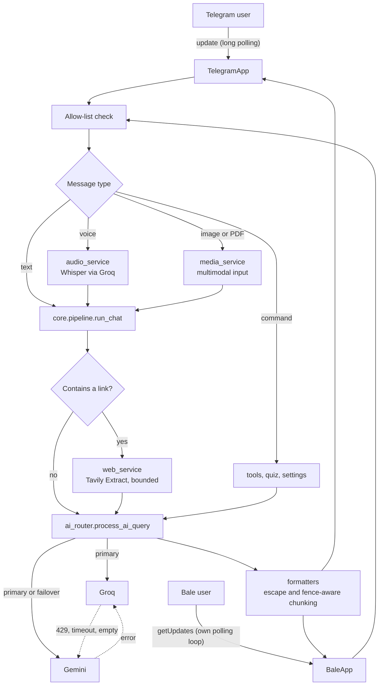

<div align="center">


<br/>

[](https://github.com/mahdi-barzegar-nazari/resilient-ai-gateway/actions/workflows/ci.yml)
[](./LICENSE)
[](./requirements.txt)
[](./Dockerfile)
[](./bot)
[](./CONTRIBUTING.md)

**A Telegram + Bale AI assistant that keeps answering when a provider does not.**
Automatic Groq ⇄ Gemini failover · voice, image, PDF and link understanding · student toolbox

**[🇮🇷 فارسی (Persian)](./README.fa.md)** · **[Architecture notes](./docs/architecture.md)**

</div>

---

## Overview

A cross-platform **Telegram + Bale** AI assistant that keeps answering when a provider does not: automatic **Groq ⇄ Gemini failover**, voice / image / PDF / link understanding, and a student toolbox (debugging help, Wikipedia and ArXiv relay, quizzes).

It is designed as a **network-boundary gateway**: users on a restricted national network talk to a domestic messenger, and this server, running outside, talks to the international AI APIs and websites on their behalf.

The codebase is layered (`bot → core → services → utils`), every behaviour listed below is pinned by an offline regression test, and the whole suite of 248 tests runs in about a tenth of a second with no API keys.

## Features

- **One brain, two messengers.** Telegram (pyTelegramBotAPI) and Bale (hand-written polling client) share a
  single platform-agnostic pipeline, so a fix or feature lands on both at once.
- **Provider failover.** Groq rate-limit (429), timeout or empty answer → the same request is replayed on
  Gemini (and vice versa), with a short note appended to the answer.
- **Multimodal input.** Voice notes (Whisper), images and PDFs (Gemini), links (Tavily Extract).
- **Message-safe output.** Code-fence-aware chunking, HTML escaping with plain-text fallback.
- **Privacy-first defaults.** Conversation memory is **off** until the user opts in; secrets are redacted from every log line.
- **Tested without the network.** 248 unit tests run in about a tenth of a second, with no API keys.

### Capabilities

| Capability | Telegram | Bale | Engine |
|---|:---:|:---:|---|
| Text chat with model switching (`/fast` `/smart` `/gemini`) | ✅ | ✅ | Groq (Qwen / GPT-OSS-120B) · Gemini |
| Automatic provider failover | ✅ | ✅ | `services/ai_router.py` |
| Voice → text → answer | ✅ | ✅ | Whisper via Groq |
| Image understanding | ✅ | ✅ | Gemini |
| PDF reading, summaries, exercise solving | ✅ | ✅ | Gemini (native `application/pdf`) |
| Link summarisation (send a URL) | ✅ | ✅ | Tavily Extract + LLM |
| Live web context for fresh questions | ✅ | ✅ | Tavily Search → Google News RSS fallback |
| `/read` (page text proxy), `/wiki`, `/arxiv`, `/arxiv_full` | ✅ | ✅ | Tavily · MediaWiki API · ArXiv API |
| `/debug` (error → root cause → fixed code) | ✅ | ✅ | Dedicated prompt, long-output mode |
| `/quiz` multiple-choice trainer with adaptive difficulty | ✅ buttons or typing | ✅ typing | LLM with a strict JSON contract |
| Exam mode (single-line answer-sheet output) | ✅ | ✅ | Dedicated prompt + low temperature |
| Inline-keyboard control panel | ✅ | — | Telegram only |
| Allow-list access control | ✅ | ✅ | `ALLOWED_USERS` |

## Quickstart

### Run locally

```bash
git clone https://github.com/mahdi-barzegar-nazari/resilient-ai-gateway.git
cd resilient-ai-gateway
python -m venv .venv && source .venv/bin/activate
pip install -r requirements.txt

cp .env.example .env        # fill in your keys; .env is git-ignored
set -a && source .env && set +a
python main.py
```

You need at least one bot token (`TELEGRAM_BOT_TOKEN` from @BotFather, or `BALE_BOT_TOKEN` from Bale's BotFather)
and at least one AI key (`GROQ_API_KEY` and/or `GEMINI_API_KEY`). Configure both AI keys to enable failover.

### Configuration

| Variable | Required | Purpose |
|---|:---:|---|
| `TELEGRAM_BOT_TOKEN` / `BALE_BOT_TOKEN` | one of them | Bot credentials. With only one set, only that platform runs. |
| `GROQ_API_KEY` | one of the AI keys | Text models and Whisper |
| `GEMINI_API_KEY` | one of the AI keys | Fallback text, **images, PDFs** |
| `TAVILY_API_KEY` | optional | Web search, link summaries, `/read` |
| `ALLOWED_USERS` | recommended | Comma-separated numeric ids; empty = open to everyone |
| `MODEL_FAST` `MODEL_SMART` `MODEL_GEMINI` `MODEL_WHISPER` | optional | Override the default model names |
| `WHISPER_LANGUAGE` | optional | Default `fa`; empty string = auto-detect |
| `PORT` | optional | Health-check server port (default 8080) |

### Deploy

- **Render:** the included `render.yaml` is a Blueprint (free web service, `/healthz` health check). Add the secrets in the dashboard.
  Free instances sleep when idle; ping `/` from an uptime monitor to keep the bot responsive.
- **Docker:** `docker build -t resilient-ai-gateway . && docker run --env-file .env -p 8080:8080 resilient-ai-gateway`

### Develop and test

```bash
python -m unittest discover -s tests -t . -v      # pytest works too
```

The suite needs **no network and no API keys**. Provider SDKs are replaced by stubs only when they are not
installed (see `tests/stubs.py`), and every network-facing method of a stub raises, so a test that forgets to
mock a call fails loudly instead of hanging. CI runs the suite on Python 3.10 – 3.12.

## Architecture

```text
.
├── main.py                    # entry point: threads + wiring
├── config.py                  # environment, model names, limits
├── bot/
│   ├── telegram_handler.py    # TelegramApp: handlers, inline keyboards, rendering
│   ├── bale_handler.py        # BaleApp: polling client, media, routing
│   └── messages.py            # user-facing texts
├── core/
│   ├── session.py             # Session + SessionStore (per platform and chat)
│   ├── pipeline.py            # run_chat: links → router → memory
│   ├── prompts.py             # system prompts, failover notes
│   └── errors.py
├── services/
│   ├── ai_router.py           # Groq ⇄ Gemini routing and failover
│   ├── clients.py             # SDK clients (incl. long-timeout PDF client)
│   ├── web_service.py         # search context, link extraction, /read
│   ├── audio_service.py       # Whisper transcription
│   ├── media_service.py       # image and PDF prompts/metadata
│   ├── knowledge_service.py   # Wikipedia and ArXiv
│   ├── quiz_service.py        # JSON-contract quiz engine
│   ├── tools.py               # /debug and the tool registry
│   └── health_server.py       # tiny Flask health endpoint
├── utils/
│   ├── formatters.py          # chunking, HTML conversion, truncation
│   ├── security.py            # allow-list, secret redaction
│   └── log.py                 # redacting log formatter
├── tests/                     # 248 offline unit tests
├── docs/                      # architecture notes, banner
├── Dockerfile · render.yaml · .env.example
├── .github/                   # CI workflow, Dependabot
└── README.md · README.fa.md · CHANGELOG.md · CONTRIBUTING.md · SECURITY.md · LICENSE
```



### Layers and the dependency rule

| Layer | Package | Responsibility |
|---|---|---|
| Adapters | `bot/` | Receive updates, enforce the allow-list, download media, render replies (HTML, chunks, keyboards). **No decision logic.** |
| Core | `core/` | `Session` state per `(platform, chat)`, the shared `run_chat` pipeline, system prompts. |
| Services | `services/` | AI router, web search & link extraction, audio, media prompts, Wikipedia/ArXiv, quiz, tools. **Never import adapters.** |
| Utils | `utils/` | Pure helpers: chunking, HTML conversion, redaction, authorization, logging. |
| Config | `config.py` | Environment variables, model names, limits. Read as `config.X` at call time so tests can override. |

Dependencies point one way: `bot → core → services → utils / config`. The only edge back is `services → core.prompts` and `core.errors`, two leaf modules that import nothing from the project, so there are no import cycles.

### Life of a message

1. The adapter (`bot/`) receives the update and checks the **allow-list**.
2. Voice is transcribed, images and PDFs become multimodal input, and commands go to the tools.
3. `core.pipeline.run_chat` extracts and summarises links (not in exam mode, not for media).
4. `ai_router` sends the request to the selected provider and replays it on the other one on failure.
5. The output is escaped, split on line boundaries without breaking code fences, and sent.

The sequence diagram of a failover, the threading model, and how to extend the project are in [`docs/architecture.md`](./docs/architecture.md).

## Engineering Challenges Solved

Each item names where it lives and which tests pin the behaviour.

**1. Provider outages must not look like outages.**
`process_ai_query` tries the user's chosen provider first and replays the identical request on the other
one on any failure, including *empty* answers. The Groq client is created with `max_retries=0` whenever a
Gemini key exists, so failover is immediate instead of waiting out SDK back-off. In exam mode the
"answered by the other provider" note is suppressed, because the answer-sheet line must stay machine-readable.
Live web context is injected only on the Gemini path. If both providers fail, the error names both causes.
→ `services/ai_router.py` · `tests/test_ai_router.py`

**2. Splitting long answers without breaking code blocks.**
Telegram and Bale cap messages at 4096 characters. `split_message` breaks on line boundaries while tracking
whether it is inside a ```` ``` ```` fence: a chunk that ends inside a block gets a closing fence and the next
chunk re-opens it, so syntax highlighting survives. Over-long single lines are hard-wrapped.
→ `utils/formatters.py` · `tests/test_formatters.py`

**3. Model output must never crash the message parser.**
Output is HTML-escaped *before* the light Markdown → Telegram-HTML conversion, and code spans are stashed
first so `**kwargs` inside code is not turned into bold. If Telegram still rejects a chunk, it is re-sent as
plain text instead of being lost. The inline keyboard is attached to the last chunk only.
→ `utils/formatters.py`, `bot/telegram_handler.py::reply`

**4. Secrets never reach logs or chat.**
File-download URLs embed the bot token, so ordinary exception messages leak it. Every user-visible error goes
through `redact_secrets`, and the log formatter scrubs the *final* line — tracebacks included.
→ `utils/security.py`, `utils/log.py` · `tests/test_security.py`

**5. A 3-second voice note was rejected as "longer than 5 minutes".**
Bale reports media duration in **milliseconds**, Telegram in seconds; comparing `3000` with a limit of `300`
rejected short messages. The adapter now normalises units (`bale_voice_seconds`), and a regression test pins
the boundary (exactly 5 minutes accepted, one millisecond more rejected).
→ `bot/bale_handler.py` · `tests/test_bale_handler.py::VoiceDurationTests`

**6. Link summaries with a bounded token budget and no prompt injection.**
A URL in a message is fetched through Tavily Extract; markdown noise and bare URLs are stripped and the text
is capped at `LINK_MAX_CHARS` (split across at most two links), cutting on sentence boundaries. The prompt
states that page content is *data, not instructions*. Long pasted text that merely contains a link is not
mistaken for a link request, and memory stores a short note instead of the page.
→ `services/web_service.py::prepare_link_prompt` · `tests/test_web_service.py`

**7. One pipeline, two platforms, isolated state.**
A `Session` dataclass per `(platform, chat_id)` replaces a dozen parallel dictionaries, so the same numeric
chat id on Telegram and Bale can never collide. `core.pipeline.run_chat` owns link handling, routing and the
memory rule ("remember only when memory is on and exam mode is off"), and passes the router a *copy* of the history.
→ `core/session.py`, `core/pipeline.py`

**8. An LLM quiz you can trust (JSON contract).**
The model must return a strict JSON object. The reply is stripped of `<think>` blocks and code fences, validated
(four options, answer in A–D, explanation present) and retried once. Every question has an id, so a stale inline
button of an earlier question can never be graded against a newer one, and grading consumes the question atomically
under a lock, so double taps are not scored twice. Difficulty adapts to the running score; recent questions are
passed back to avoid repeats.
→ `services/quiz_service.py` · `tests/test_quiz_and_tools.py`

**9. PDFs are heavy.**
Gemini receives the file inline as `application/pdf` through a dedicated client with a longer timeout (180 s vs 60 s).
The size cap (15 MB) accounts for the ~33 % base64 overhead, is checked before *and* after download, and is
enforced for ArXiv papers as well.
→ `services/clients.py`, `services/media_service.py`

**10. A polling loop that survives bad days.**
Bale has no official SDK, so `BaleApp.run` implements long polling by hand: the offset advances *before* an
update is handled (a poisoned update is skipped, not retried forever), one failing update never blocks the rest,
network errors back off for 2 s and are logged once per outage instead of every retry.
→ `bot/bale_handler.py::poll_once/run` · `tests/test_bale_handler.py::PollingTests`

**11. Access control everywhere.**
The allow-list covers commands, free text, inline-keyboard presses, voice, photos and documents — nothing is
downloaded for an unauthorised user. An unauthorised Bale user is shown their numeric id so the owner knows
what to put in `ALLOWED_USERS`.

## Commands

| Command | What it does |
|---|---|
| `/start`, `/panel`, `/menu` | Welcome + quick-access inline keyboard (Telegram) |
| `/fast` `/smart` `/gemini` | Choose the engine |
| `/memory_on` `/memory_off` `/clear` | Conversation memory (off by default) |
| `/exam_on` `/exam_off` | Single-line "answer sheet" output for language tests |
| `/long_on` `/long_off` | Long, complete output (full code files) |
| `/debug <error or code>` | Root cause → step-by-step fix → corrected code → prevention |
| `/read <url>` | Cleaned full text of a page (text proxy for blocked sites) |
| `/wiki <topic>` | Full Wikipedia article text (Persian or English) |
| `/arxiv <query or id>` | Search papers, or show an abstract |
| `/arxiv_full <id>` | Persian structured summary of the whole paper (Gemini reads the PDF) |
| `/quiz [topic]`, `/quiz_stop` | Multiple-choice trainer and final score |
| send a **URL** | Analytical summary of the page |
| send a **PDF** (caption = instruction) | Summary, key points or solved exercises |
| send a **voice note / photo** | Transcribed and answered / analysed |
| `/web <query>`, `/testweb` | Telegram only: force a live web answer / inspect raw search output |

## Quality Gates

| Gate | Tool | Where it runs |
| :--- | :--- | :--- |
| 248 offline unit tests, no network and no API keys | `unittest` (Python 3.10 to 3.12) | CI, local |
| Every module byte-compiles | `compileall` | CI |
| Secret redaction in errors and logs | [`tests/test_security.py`](./tests/test_security.py) | CI |
| Dependency and base-image updates | Dependabot (pip, Docker, Actions) | Weekly |

Linting and static typing are not configured yet; see the roadmap.

## Trade-offs and Roadmap

- [ ] **State is in memory.** Sessions, memory and quiz progress reset on restart. Next step: SQLite or Redis behind the `SessionStore` interface.
- [ ] **Bale updates are handled sequentially.** A slow model call delays other Bale users. Next step: a per-chat worker pool.
- [ ] **Search is triggered by keyword heuristics** (`should_search_web`). Next step: let the model decide through tool calling.
- [ ] **Images and PDFs are Gemini-only**, so they have no failover. PDFs are uploaded inline (15 MB cap); the Files API would lift that.
- [ ] **No per-user rate limiting** yet; the allow-list is the only abuse control.
- [ ] **Lint and typing.** Add Ruff and a static type checker to CI.

## Security

- Keep `.env` out of version control (it is in `.gitignore`); rotate any token that was ever committed.
- Set `ALLOWED_USERS` on any public deployment: every message costs provider quota.
- Page text fetched from links is treated as untrusted data in the prompt; it is still model input, so do not give this bot tools that can act on the outside world without further hardening.
- Report vulnerabilities privately, as described in [`SECURITY.md`](./SECURITY.md).

## Contributing

Bug reports and pull requests are welcome. Read [`CONTRIBUTING.md`](./CONTRIBUTING.md) for the setup, the testing rules, and the checklist.

## License

Released under the [MIT License](./LICENSE).

Maintained by [Mahdi Barzegar Nazari](https://github.com/mahdi-barzegar-nazari).
