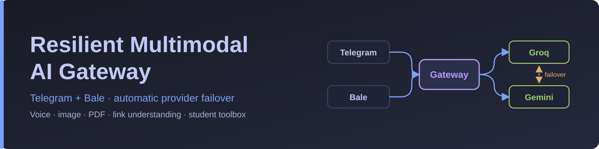
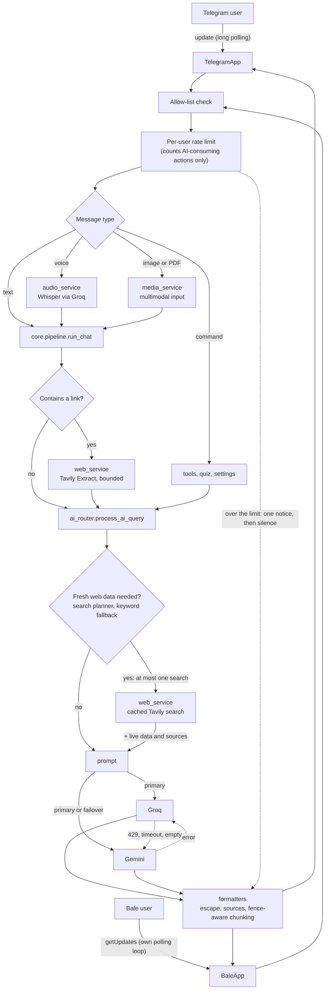

<div align="center">



<br/>

[](https://github.com/mahdi-barzegar-nazari/resilient-ai-gateway/actions/workflows/ci.yml)
[](https://github.com/astral-sh/ruff)
[](./LICENSE)
[](./requirements.txt)
[](./Dockerfile)
[](./bot)
[](./CONTRIBUTING.md)

**A Telegram + Bale AI assistant that keeps answering when a provider does not.**
Automatic Groq ⇄ Gemini failover · voice, image, PDF and link understanding · student toolbox

**[🇮🇷 فارسی (Persian)](./README.fa.md)** · **[Architecture notes](./docs/architecture.md)**

</div>

---

## Overview

A cross-platform **Telegram + Bale** AI assistant that keeps answering when a provider does not: automatic **Groq ⇄ Gemini failover**, voice / image / PDF / link understanding, and a student toolbox (debugging help, Wikipedia and ArXiv relay, quizzes).

It is designed as a **network-boundary gateway**: users on a restricted national network talk to a domestic messenger, and this server, running outside, talks to the international AI APIs and websites on their behalf.

The codebase is layered (`bot → core → services → utils`), every behaviour listed below is pinned by an offline regression test, and the whole suite of 612 tests runs in well under a second with no API keys.

## Features

- **One brain, two messengers.** Telegram (pyTelegramBotAPI) and Bale (hand-written polling client) share a
  single platform-agnostic pipeline, so a fix or feature lands on both at once.
- **Provider failover.** Groq rate-limit (429), timeout or empty answer → the same request is replayed on
  Gemini (and vice versa), with a short note appended to the answer.
- **Several API keys per provider.** `GROQ_API_KEYS`, `GEMINI_API_KEYS` and `TAVILY_API_KEYS` take comma-separated
  keys; requests rotate round-robin, and a key that is rate limited, times out or fails is skipped for a while.
  One key behaves exactly as before.
- **Per-user rate limiting.** Each user gets 20 AI-consuming requests per 60 seconds (`RATE_LIMIT_MAX`,
  `RATE_LIMIT_WINDOW_SECONDS`; `0` turns it off), counted separately on Telegram and Bale. Over the limit, the user
  gets one short notice with the seconds to wait; commands that cost no quota are never counted.
- **Multimodal input.** Voice notes (Whisper), images and PDFs (Gemini), links (Tavily Extract).
- **Smart web search.** A tiny planner call (fast Groq model, Gemini as backup) decides whether a message needs fresh
  web data and writes the search query from the last few messages, so a follow-up like "and the euro?" works. It serves
  every engine, identical queries are cached for 10 minutes, and an answer that used the web ends with up to three
  source links under «منابع:». If the planner fails, the old keyword heuristic takes over.
- **Message-safe output.** Code-fence-aware chunking, HTML escaping with plain-text fallback.
- **Privacy-first defaults.** Conversation memory is **off** until the user opts in; secrets are redacted from every log line.
- **Tested without the network.** 612 unit tests run in well under a second, with no API keys.

### Capabilities

| Capability | Telegram | Bale | Engine |
|---|:---:|:---:|---|
| Text chat with model switching (`/fast` `/smart` `/gemini`) | ✅ | ✅ | Groq (Qwen / GPT-OSS-120B) · Gemini |
| Automatic provider failover | ✅ | ✅ | `services/ai_router.py` |
| Voice → text → answer | ✅ | ✅ | Whisper via Groq |
| Image understanding | ✅ | ✅ | Gemini |
| PDF reading, summaries, exercise solving | ✅ | ✅ | Gemini (native `application/pdf`) |
| Link summarisation (send a URL) | ✅ | ✅ | Tavily Extract + LLM |
| Live web context for fresh questions, with source links | ✅ | ✅ | Search planner (fast Groq model) → Tavily Search → Google News RSS fallback |
| `/read` (page text proxy), `/wiki`, `/arxiv`, `/arxiv_full` | ✅ | ✅ | Tavily · MediaWiki API · ArXiv API |
| `/debug` (error → root cause → fixed code) | ✅ | ✅ | Dedicated prompt, long-output mode |
| `/quiz` multiple-choice trainer with adaptive difficulty | ✅ buttons or typing | ✅ typing | LLM with a strict JSON contract |
| Exam mode (single-line answer-sheet output) | ✅ | ✅ | Dedicated prompt + low temperature |
| Inline-keyboard control panel | ✅ | — | Telegram only |
| Allow-list access control | ✅ | ✅ | `ALLOWED_USERS` |
| Per-user rate limit (sliding window) | ✅ | ✅ | `core/ratelimit.py` |

## Quickstart

### Run locally

```bash
git clone https://github.com/mahdi-barzegar-nazari/resilient-ai-gateway.git
cd resilient-ai-gateway
python -m venv .venv && source .venv/bin/activate
pip install -r requirements.txt

cp .env.example .env        # fill in your keys; .env is git-ignored
set -a && source .env && set +a
python main.py
```

You need at least one bot token (`TELEGRAM_BOT_TOKEN` from @BotFather, or `BALE_BOT_TOKEN` from Bale's BotFather)
and at least one AI key (`GROQ_API_KEY` and/or `GEMINI_API_KEY`). Configure both AI keys to enable failover.
Each provider also accepts several keys (`GROQ_API_KEYS`, `GEMINI_API_KEYS`, `TAVILY_API_KEYS`); see the table below.

### Configuration

| Variable | Required | Purpose |
|---|:---:|---|
| `TELEGRAM_BOT_TOKEN` / `BALE_BOT_TOKEN` | one of them | Bot credentials. With only one set, only that platform runs. |
| `GROQ_API_KEY` | one of the AI keys | Text models and Whisper |
| `GEMINI_API_KEY` | one of the AI keys | Fallback text, **images, PDFs** |
| `TAVILY_API_KEY` | optional | Web search, link summaries, `/read` |
| `GROQ_API_KEYS` `GEMINI_API_KEYS` `TAVILY_API_KEYS` | optional | Extra keys, comma-separated, merged with the singular variables above (spaces and empty items are ignored, duplicates removed). With two or more keys per provider, requests rotate round-robin. |
| `KEY_MAX_ATTEMPTS` `KEY_RETRY_BUDGET_SECONDS` | optional | Rotation bounds: keys tried per request (default 3) and the time after which no further key is tried (default 90 s) |
| `KEY_COOLDOWN_RATE_LIMIT` `KEY_COOLDOWN_RATE_LIMIT_MAX` `KEY_COOLDOWN_TRANSIENT` `KEY_COOLDOWN_AUTH` | optional | Seconds a key is skipped after: a 429 without `Retry-After` (60), the cap for `Retry-After` (300), a timeout, connection error or 5xx (15), a 401/403 (3600) |
| `SEARCH_PLANNER_ENABLED` `SEARCH_PLANNER_TIMEOUT_SECONDS` `SEARCH_CACHE_TTL_SECONDS` | optional | Smart web search. The planner is on by default (`false` = keyword heuristic only); one planner call may take 4 s at most (minimum 0.5); identical search queries are reused for 600 s (`0` turns the cache off) |
| `ALLOWED_USERS` | recommended | Comma-separated numeric ids; empty = open to everyone |
| `RATE_LIMIT_MAX` `RATE_LIMIT_WINDOW_SECONDS` | optional | Per-user rate limit: AI-consuming requests allowed per window, counted separately for each platform (defaults: 20 per 60 s). `RATE_LIMIT_MAX=0` turns it off. |
| `MODEL_FAST` `MODEL_SMART` `MODEL_GEMINI` `MODEL_WHISPER` | optional | Override the default model names |
| `WHISPER_LANGUAGE` | optional | Default `fa`; empty string = auto-detect |
| `PORT` | optional | Health-check server port (default 8080) |

### Deploy

- **Render:** the included `render.yaml` is a Blueprint (free web service, `/healthz` health check). Add the secrets in the dashboard.
  Free instances sleep when idle; ping `/` from an uptime monitor to keep the bot responsive.
- **Docker:** `docker build -t resilient-ai-gateway . && docker run --env-file .env -p 8080:8080 resilient-ai-gateway`

### Develop and test

```bash
python -m unittest discover -s tests -t . -v      # pytest works too
```

The suite needs **no network and no API keys**. Provider SDKs are replaced by stubs only when they are not
installed (see `tests/stubs.py`), and every network-facing method of a stub raises, so a test that forgets to
mock a call fails loudly instead of hanging. CI runs the suite on Python 3.10 – 3.12.

## Architecture

```text
.
├── main.py                    # entry point: threads + wiring
├── config.py                  # environment, model names, limits
├── bot/
│   ├── telegram_handler.py    # TelegramApp: handlers, inline keyboards, rendering
│   ├── bale_handler.py        # BaleApp: polling client, media, routing
│   └── messages.py            # user-facing texts
├── core/
│   ├── session.py             # Session + SessionStore (per platform and chat)
│   ├── pipeline.py            # run_chat: links → router → memory
│   ├── ratelimit.py           # per-user rate limit (sliding window)
│   ├── prompts.py             # system prompts, failover notes
│   └── errors.py
├── services/
│   ├── ai_router.py           # Groq ⇄ Gemini routing and failover
│   ├── search_planner.py      # LLM search planner: needs the web? which query?
│   ├── clients.py             # SDK clients (incl. long-timeout PDF client)
│   ├── key_pool.py            # API-key rotation: round-robin, cooldowns
│   ├── web_service.py         # search, result cache, sources, link extraction, /read
│   ├── audio_service.py       # Whisper transcription
│   ├── media_service.py       # image and PDF prompts/metadata
│   ├── knowledge_service.py   # Wikipedia and ArXiv
│   ├── quiz_service.py        # JSON-contract quiz engine
│   ├── tools.py               # /debug and the tool registry
│   └── health_server.py       # tiny Flask health endpoint
├── utils/
│   ├── formatters.py          # chunking, HTML conversion, truncation
│   ├── security.py            # allow-list, secret redaction
│   └── log.py                 # redacting log formatter
├── tests/                     # 612 offline unit tests
├── docs/                      # architecture notes, banner
├── Dockerfile · render.yaml · .env.example
├── .github/                   # CI workflow, Dependabot
└── README.md · README.fa.md · CHANGELOG.md · CONTRIBUTING.md · SECURITY.md · LICENSE
```



### Layers and the dependency rule

| Layer | Package | Responsibility |
|---|---|---|
| Adapters | `bot/` | Receive updates, enforce the allow-list, apply the per-user rate limit, download media, render replies (HTML, chunks, keyboards). **No decision logic.** |
| Core | `core/` | `Session` state per `(platform, chat)`, the shared `run_chat` pipeline, the per-user rate limiter, system prompts. |
| Services | `services/` | AI router, API-key rotation, web search & link extraction, audio, media prompts, Wikipedia/ArXiv, quiz, tools. **Never import adapters.** |
| Utils | `utils/` | Pure helpers: chunking, HTML conversion, redaction, authorization, logging. |
| Config | `config.py` | Environment variables, model names, limits. Read as `config.X` at call time so tests can override. |

Dependencies point one way: `bot → core → services → utils / config`. The only edge back is `services → core.prompts` and `core.errors`, two leaf modules that import nothing from the project, so there are no import cycles.

### Life of a message

1. The adapter (`bot/`) receives the update and checks the **allow-list**.
2. Each request that can spend provider quota (free text, voice, images, PDFs and every command that calls Groq, Gemini or Tavily) is counted against the user's **rate limit**. Over the limit, the user gets one short notice and the request stops there: nothing is downloaded and no provider is called.
3. Voice is transcribed, images and PDFs become multimodal input, and commands go to the tools.
4. `core.pipeline.run_chat` extracts and summarises links (not in exam mode, not for media).
5. `ai_router` asks the search planner whether the message needs fresh web data (never in exam mode, for link summaries, images or PDFs). If it does, one cached search is made and its results join the prompt.
6. The router sends that prompt to the selected provider and replays it, web data included, on the other one on failure.
7. When web results were used, up to three source links are appended under the answer (never in exam mode, never stored in memory).
8. The output is escaped, split on line boundaries without breaking code fences, and sent.

The sequence diagram of a failover, the threading model, and how to extend the project are in [`docs/architecture.md`](./docs/architecture.md).

## Engineering Challenges Solved

Each item names where it lives and which tests pin the behaviour.

**1. Provider outages must not look like outages.**
`process_ai_query` tries the user's chosen provider first and replays the identical request on the other
one on any failure, including *empty* answers. The Groq client is created with `max_retries=0` whenever a
Gemini key exists, so failover is immediate instead of waiting out SDK back-off. In exam mode the
"answered by the other provider" note is suppressed, because the answer-sheet line must stay machine-readable.
Live web context reaches whichever provider answers: it is fetched once, before the first call, and replayed unchanged on failover. If both providers fail, the error names both causes.
→ `services/ai_router.py` · `tests/test_ai_router.py`

**2. Splitting long answers without breaking code blocks.**
Telegram and Bale cap messages at 4096 characters. `split_message` breaks on line boundaries while tracking
whether it is inside a ```` ``` ```` fence: a chunk that ends inside a block gets a closing fence and the next
chunk re-opens it, so syntax highlighting survives. Over-long single lines are hard-wrapped.
→ `utils/formatters.py` · `tests/test_formatters.py`

**3. Model output must never crash the message parser.**
Output is HTML-escaped *before* the light Markdown → Telegram-HTML conversion, and code spans are stashed
first so `**kwargs` inside code is not turned into bold. If Telegram still rejects a chunk, it is re-sent as
plain text instead of being lost. The inline keyboard is attached to the last chunk only.
→ `utils/formatters.py`, `bot/telegram_handler.py::reply`

**4. Secrets never reach logs or chat.**
File-download URLs embed the bot token, so ordinary exception messages leak it. Every user-visible error goes
through `redact_secrets`, and the log formatter scrubs the *final* line — tracebacks included.
→ `utils/security.py`, `utils/log.py` · `tests/test_security.py`

**5. A 3-second voice note was rejected as "longer than 5 minutes".**
Bale reports media duration in **milliseconds**, Telegram in seconds; comparing `3000` with a limit of `300`
rejected short messages. The adapter now normalises units (`bale_voice_seconds`), and a regression test pins
the boundary (exactly 5 minutes accepted, one millisecond more rejected).
→ `bot/bale_handler.py` · `tests/test_bale_handler.py::VoiceDurationTests`

**6. Link summaries with a bounded token budget and no prompt injection.**
A URL in a message is fetched through Tavily Extract; markdown noise and bare URLs are stripped and the text
is capped at `LINK_MAX_CHARS` (split across at most two links), cutting on sentence boundaries. The prompt
states that page content is *data, not instructions*. Long pasted text that merely contains a link is not
mistaken for a link request, and memory stores a short note instead of the page.
→ `services/web_service.py::prepare_link_prompt` · `tests/test_web_service.py`

**7. One pipeline, two platforms, isolated state.**
A `Session` dataclass per `(platform, chat_id)` replaces a dozen parallel dictionaries, so the same numeric
chat id on Telegram and Bale can never collide. `core.pipeline.run_chat` owns link handling, routing and the
memory rule ("remember only when memory is on and exam mode is off"), and passes the router a *copy* of the history.
→ `core/session.py`, `core/pipeline.py`

**8. An LLM quiz you can trust (JSON contract).**
The model must return a strict JSON object. The reply is stripped of `<think>` blocks and code fences, validated
(four options, answer in A–D, explanation present) and retried once. Every question has an id, so a stale inline
button of an earlier question can never be graded against a newer one, and grading consumes the question atomically
under a lock, so double taps are not scored twice. Difficulty adapts to the running score; recent questions are
passed back to avoid repeats.
→ `services/quiz_service.py` · `tests/test_quiz_and_tools.py`

**9. PDFs are heavy.**
Gemini receives the file inline as `application/pdf` through a dedicated client with a longer timeout (180 s vs 60 s).
The size cap (15 MB) accounts for the ~33 % base64 overhead, is checked before *and* after download, and is
enforced for ArXiv papers as well.
→ `services/clients.py`, `services/media_service.py`

**10. A polling loop that survives bad days.**
Bale has no official SDK, so `BaleApp.run` implements long polling by hand: the offset advances *before* an
update is handled (a poisoned update is skipped, not retried forever), one failing update never blocks the rest,
network errors back off for 2 s and are logged once per outage instead of every retry.
→ `bot/bale_handler.py::poll_once/run` · `tests/test_bale_handler.py::PollingTests`

**11. Access control everywhere.**
The allow-list covers commands, free text, inline-keyboard presses, voice, photos and documents — nothing is
downloaded for an unauthorised user. An unauthorised Bale user is shown their numeric id so the owner knows
what to put in `ALLOWED_USERS`.

**12. Several API keys per provider, rotated without waiting.**
With two or more keys, `services/key_pool.py` hands them out round-robin and retries the *same* request on the
next key after a 429/quota (a capped `Retry-After` is honoured), timeout, connection error, 5xx or empty answer.
A 401/403 benches the key for an hour; a 400-class request error is never replayed, because another key cannot
fix it. Each key is tried at most once per request, attempts are capped by `KEY_MAX_ATTEMPTS` and a time budget,
and SDK-level retries are switched off, so the worst case stays bounded. When every key is cooling down the call
fails immediately, so the Groq ⇄ Gemini failover (challenge 1) takes over without any waiting. A single key
bypasses the pool and behaves exactly as before. Keys appear in logs only as provider and position, and every
key of every list is redacted.
→ `services/key_pool.py`, `services/clients.py` · `tests/test_key_pool.py`, `tests/test_key_rotation.py`

**13. Per-user rate limiting that both messengers share.**
`core/ratelimit.py` keeps a sliding-window log per `(platform, user id)`: 20 requests per 60 s by default, one lock,
an injectable clock, and only *accepted* requests recorded, so spamming never extends a block. The adapters call it
right after the allow-list and before any download or provider call, and only for actions that can spend quota:
free text, voice, photos, PDFs and the commands that call Groq, Gemini or Tavily. `/start`, the panel, settings,
`/clear`, quiz grading, `/quiz_stop`, `/wiki` and `/arxiv` are free. An over-limit user gets one Persian notice per
window with the seconds to wait, then silence. Entries are swept out once their window and notice cooldown are over,
so memory follows the users active in the last minute, not everyone ever seen.
→ `core/ratelimit.py`, `bot/telegram_handler.py` and `bot/bale_handler.py` (`_within_limit`) · `tests/test_ratelimit.py`, `tests/test_ratelimit_adapters.py`

**14. Web search that decides for itself.**
A keyword list cannot tell "قیمت دلار" from "explain price theory", knows nothing about follow-ups, and used to run on
the Gemini path only. `services/search_planner.py` now makes one tiny call (fast Groq model, Gemini if Groq is missing
or fails; temperature 0, 4 s timeout, strict JSON `{"search": bool, "query": str}`) that sees the last few messages
of history, so "and the euro?" becomes a complete query. The reply is parsed defensively (code fences and `<think>`
blocks stripped, types validated), and any failure, timeout or invalid JSON falls back to the old keyword heuristic, so
the planner can never block an answer. Greetings, very short messages and explicit "search ..." phrases skip the call.
The search runs at most once per message, before the first provider is called, so Groq-first, Gemini-first and failover
all see the same web data; identical queries come from a bounded, thread-safe TTL cache (10 minutes, injectable clock).
An answer that used web data gets up to three plain-text source links under «منابع:», rendered identically on Telegram
(HTML) and Bale, never stored in memory and never shown in exam mode. The planner uses the normal key rotation and is
not counted as an extra request by the rate limiter.
→ `services/search_planner.py`, `services/web_service.py`, `services/ai_router.py`, `core/pipeline.py` · `tests/test_search_planner.py`, `tests/test_smart_search.py`

## Commands

| Command | What it does |
|---|---|
| `/start`, `/panel`, `/menu` | Welcome + quick-access inline keyboard (Telegram) |
| `/fast` `/smart` `/gemini` | Choose the engine |
| `/memory_on` `/memory_off` `/clear` | Conversation memory (off by default) |
| `/exam_on` `/exam_off` | Single-line "answer sheet" output for language tests |
| `/long_on` `/long_off` | Long, complete output (full code files) |
| `/debug <error or code>` | Root cause → step-by-step fix → corrected code → prevention |
| `/read <url>` | Cleaned full text of a page (text proxy for blocked sites) |
| `/wiki <topic>` | Full Wikipedia article text (Persian or English) |
| `/arxiv <query or id>` | Search papers, or show an abstract |
| `/arxiv_full <id>` | Persian structured summary of the whole paper (Gemini reads the PDF) |
| `/quiz [topic]`, `/quiz_stop` | Multiple-choice trainer and final score |
| send a **URL** | Analytical summary of the page |
| send a **PDF** (caption = instruction) | Summary, key points or solved exercises |
| send a **voice note / photo** | Transcribed and answered / analysed |
| `/web <query>`, `/testweb` | Telegram only: force a live web answer / inspect raw search output |

Free-text questions search the web by themselves when they need fresh data; `/web` always does, with Gemini, and is unchanged. Free text, voice notes, images, PDFs and every command that calls Groq, Gemini or Tavily count towards the per-user rate limit. `/start`, `/panel`, the settings commands, `/clear`, quiz answers, `/quiz_stop`, `/wiki` and `/arxiv` do not.

## Quality Gates

| Gate | Tool | Where it runs |
| :--- | :--- | :--- |
| 612 offline unit tests, no network and no API keys | `unittest` (Python 3.10 to 3.12) | CI, local |
| Every module byte-compiles | `compileall` | CI |
| Lint for likely bugs: pycodestyle, Pyflakes and bugbear rules (`E`, `F`, `W`, `B`), no auto-formatting | [Ruff](https://docs.astral.sh/ruff/) (`ruff check .`) | CI (Python 3.12), local |
| Secret redaction in errors and logs | [`tests/test_security.py`](./tests/test_security.py) | CI |
| Dependency and base-image updates | Dependabot (pip, Docker, Actions) | Weekly |

Static type checking is not configured yet; see the roadmap.

## Trade-offs and Roadmap

- [ ] **State is in memory.** Sessions, memory, quiz progress and rate-limit counters reset on restart. Next step: SQLite or Redis behind the `SessionStore` interface.
- [ ] **Bale updates are handled sequentially.** A slow model call delays other Bale users. Next step: a per-chat worker pool.
- [ ] **Images and PDFs are Gemini-only**, so they have no failover. PDFs are uploaded inline (15 MB cap); the Files API would lift that.
- [ ] **Key cooldowns are in memory and per key, not per model.** They reset on restart, and a rate limit on one Groq model (or on Whisper) also rests the key for the others. Next step: track cooldowns per `(key, model)`, and share them between instances if the bot ever scales out.
- [ ] **Static typing.** Add a static type checker to CI.

## Security

- Keep `.env` out of version control (it is in `.gitignore`); rotate any token that was ever committed.
- Set `ALLOWED_USERS` on any public deployment: every message costs provider quota. The per-user rate limit (on by default) caps how fast each user can spend it, but it does not replace the allow-list.
- Page text fetched from links is treated as untrusted data in the prompt; it is still model input, so do not give this bot tools that can act on the outside world without further hardening.
- Report vulnerabilities privately, as described in [`SECURITY.md`](./SECURITY.md).

## Contributing

Bug reports and pull requests are welcome. Read [`CONTRIBUTING.md`](./CONTRIBUTING.md) for the setup, the testing rules, and the checklist.

## License

Released under the [MIT License](./LICENSE).

Maintained by [Mahdi Barzegar Nazari](https://github.com/mahdi-barzegar-nazari).
