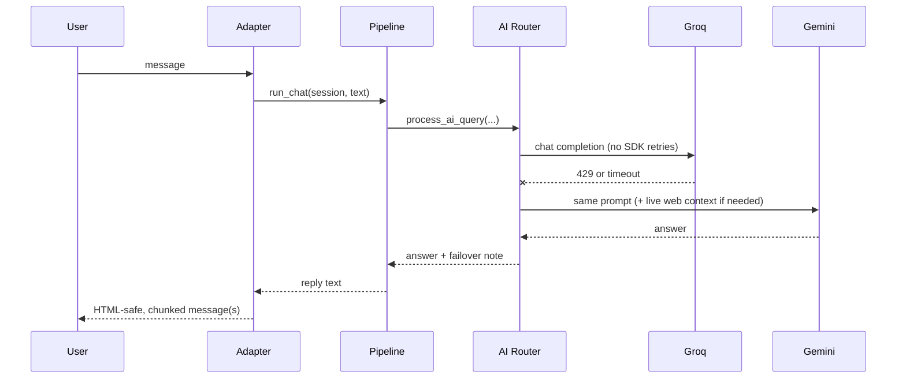

# Architecture

How the gateway is built, why it is built that way, and where to change it. For installation and usage see the [README](../README.md).

## Design goals

1. **A provider outage must not look like an outage.** The same request is replayed on the other provider, transparently.
2. **One behaviour, two messengers.** Adapters stay thin; every decision lives in a shared pipeline.
3. **Safe by default.** Conversation memory is opt-in, access can be restricted to an allow-list, and secrets are scrubbed from errors and logs.
4. **Testable offline.** No test needs a network connection, an API key, or a real SDK.

## Layers and the dependency rule

| Layer | Package | Rule |
| :--- | :--- | :--- |
| Adapters | `bot/` | Talk to one messenger. Check the allow-list, download media, render replies. **No decision logic.** |
| Core | `core/` | `Session` state and the shared `run_chat` pipeline. |
| Services | `services/` | Provider routing, API-key rotation, web, audio, media, knowledge, quiz, tools. **Never import `bot/`.** |
| Utils | `utils/` | Pure helpers with no knowledge of the layers above. |
| Config | `config.py` | Read as `config.NAME` at call time, never `from config import NAME`, so tests can patch a value. |

The direction is `bot → core → services → utils / config`. The only edge back is `services → core.prompts` and `core.errors`, which are leaf modules (they import nothing from the project), so there are no import cycles. Adding a third messenger therefore means writing one new adapter and touching nothing else.

## Process and thread model

`main.py` starts up to three loops in one process:

| Loop | Thread | Started when |
| :--- | :--- | :--- |
| Health server (Flask, `/` and `/healthz`) | daemon | always |
| Bale long polling (hand-written client) | daemon | `BALE_BOT_TOKEN` is set |
| Telegram long polling (pyTelegramBotAPI) | **main** | `TELEGRAM_BOT_TOKEN` is set |

If Telegram is not configured, Bale runs on the main thread instead. With neither token the process logs an error and exits with status 1. The health server exists because free hosting tiers expect a web service listening on `$PORT`.

## Request lifecycle

The flowchart in the [README](../README.md#architecture) shows the full routing. The core of it is `core.pipeline.run_chat(session, user_text, image=None, memory_text=None)`:

1. Unless the chat is in exam mode or the input is media, links in the text are fetched and turned into a bounded prompt (`prepare_link_prompt`). Live web search is then switched off, because the page text is already in the prompt.
2. `process_ai_query` routes the request (see below).
3. The exchange is stored only when memory is on **and** exam mode is off. For links and media a short note is stored instead of the large prompt.
4. The function never raises: any failure becomes readable, secret-free text.

## Provider routing and failover

Routing rules, all in `services/ai_router.py`:

- **Images and PDFs always go to Gemini.** It is the only multimodal provider, so there is no failover path for them.
- **The user's selected model decides who is tried first.** `/gemini` (or a missing Groq key) means Gemini first; otherwise Groq first.
- **Any failure replays the same request on the other provider.** That includes HTTP 429, timeouts and *empty* answers. The reply gets a short note saying the other provider answered.
- **Exam mode suppresses the note**, because the answer-sheet line must stay machine-readable.
- **Live web context is added only on the Gemini path.**
- **If both providers fail**, the raised error names both causes (secrets redacted).
- **Groq fails fast.** When a Gemini key exists the Groq client is built with `max_retries=0`, so failover does not wait for SDK back-off. PDFs use a separate Gemini client with a 180 s timeout instead of 60 s.
- **Several keys per provider are handled below this layer** (see the next section). To the router a provider call still either succeeds or raises, so everything above is unchanged.

## API key rotation

Each provider accepts several keys: `GROQ_API_KEYS`, `GEMINI_API_KEYS` and `TAVILY_API_KEYS` (comma-separated; spaces and empty items ignored, duplicates removed). `config.api_keys("groq" | "gemini" | "tavily")` merges them with the singular `*_API_KEY` variable (singular first) at call time. The mechanism lives in `services/key_pool.py`; `services/clients.py` and `services/web_service.py` plug it in.

**Where it applies.** The router and the other callers were not rewritten: the SDK client objects they already use are replaced by rotating facades when a provider has two or more keys.

| Call site | Pool | Hook |
| :--- | :--- | :--- |
| Groq chat (`ai_router.call_groq`) | `groq` | `clients.groq_client.chat.completions.create`; an empty answer rotates |
| Whisper (`audio_service.transcribe_audio`) | `groq` | `audio.transcriptions.create`; an empty transcript is valid (silence) and does not rotate |
| Gemini text and images (`ai_router.call_gemini`) | `gemini` | `clients.gemini_client`; an empty answer rotates |
| Gemini PDFs, long timeout | `gemini` | `clients.gemini_pdf_client`, **the same pool**, so a cooldown learned by one client holds for the other |
| `/arxiv_full` (`knowledge_service`) | `gemini` | No key of its own: Wikipedia and ArXiv are keyless, and the PDF reaches Gemini through `process_ai_query`, i.e. the PDF client |
| Tavily search, link extraction, `/read` | `tavily` | `web_service._tavily_post` over `web_service.tavily_pool` |

**What happens to a request.** The next key in round-robin order that is not cooling down is used. On a rotatable failure that key is put on cooldown and the **same request** is retried on the next key:

| Failure | Cooldown (constant in `config.py`) | Rotates? |
| :--- | :--- | :--- |
| HTTP 429 / quota (Tavily also 432, 433) | `Retry-After` if present, capped at `KEY_COOLDOWN_RATE_LIMIT_MAX` (300 s); else `KEY_COOLDOWN_RATE_LIMIT` (60 s) | yes |
| Timeout, connection error, HTTP 5xx or 408 | `KEY_COOLDOWN_TRANSIENT` (15 s) | yes |
| HTTP 401 / 403 (and Gemini's 400 `API_KEY_INVALID`) | `KEY_COOLDOWN_AUTH` (3600 s) | yes |
| Empty answer | none: it says something about the prompt, not the key | yes |
| Any other 4xx (400, 404, 413, 422 ...) and any unexpected exception | none | **no**, raised as is |

**Bounds.** A key is tried at most once per request and at most `KEY_MAX_ATTEMPTS` (3) keys are tried. No new attempt starts once `KEY_RETRY_BUDGET_SECONDS` (90 s) have passed, so the worst case is below that budget plus one attempt's timeout (under 150 s with the 60 s clients, under 270 s with the 180 s PDF client), instead of attempts times timeout. Each per-key Groq client is created with `max_retries=0`, so SDK back-off cannot multiply this. The Gemini clients are built without `retry_options`; if a future SDK version retries by default, pass `HttpRetryOptions(attempts=1)` in `_make_gemini`.

**Exhaustion.** When every key of a provider is cooling down, the call raises `AllKeysCoolingDown` (a `RuntimeError`) **before any network call and without sleeping**. The router treats it like any other provider error, so the Groq ⇄ Gemini failover takes over at once. If the keys run out in the middle of a request, the last real error is raised; for a response-based failure (a Tavily 429) the last response is returned so each caller keeps deciding what a non-200 means.

**One key is a pass-through.** With exactly one key, `clients.py` returns the plain SDK client built exactly as before (including `max_retries=0 if Gemini else 2`) and the pool never cools it down, logs, or retries. Single-key deployments behave as they did before rotation existed.

**State and threads.** Cooldowns and the round-robin cursor are in memory, per provider, behind one lock; the provider call runs outside the lock. The cursor advances atomically on every attempt, so concurrent requests are spread evenly. Time comes from `key_pool.clock` (or the `clock=` argument of `KeyPool`), which is why tests never sleep. Cooldowns are per key, not per model: a 429 on Whisper also rests that Groq key for chat.

**Logs and secrets.** One INFO line per rotation, naming only the provider and the key's position, e.g. `[key-rotation] groq key #1/3 rate limited (cooldown 60s); rotating to key #2/3`. No part of a key is ever logged, and `_secrets()` in `utils/security.py` returns every key of every list, so `redact_secrets` masks them all (longest first, so a key that is a prefix of another leaves no readable tail). Users see no message about rotation.

## State model

State is one `Session` dataclass per `(platform, chat_id)`, held in a thread-safe `SessionStore`:

| Field | Meaning |
| :--- | :--- |
| `model` | Selected engine (`/fast`, `/smart`, `/gemini`) |
| `memory_on` | Conversation memory; **off by default** |
| `exam_mode`, `long_mode` | Output modes |
| `history` | Last `MAX_HISTORY_MESSAGES` messages (10) while memory is on |
| `quiz`, `quiz_stats` | The question awaiting an answer, and the running score |
| `lock` | Makes quiz grading atomic, so a double tap is scored once |

The key includes the platform, so chat id `42` on Telegram and on Bale are different sessions. Everything is in memory and resets on restart (see the roadmap in the README).

## Errors and secrets

- **Allow-list everywhere.** Commands, free text, inline-keyboard presses, voice, photos and documents all pass `is_authorized` (Telegram) or `is_authorized_bale` (Bale: sender or chat) before anything is downloaded.
- **`redact_secrets`** replaces every configured token and key, including every key of the `*_API_KEYS` lists, with `***`. Every user-visible error goes through it, because file-download URLs embed the bot token.
- **`RedactingFormatter`** scrubs the *final* log line, tracebacks included. The `urllib3` logger is raised to `WARNING` because its `DEBUG` lines print full URLs.
- **Page text is data, not instructions.** The link-summary prompt tells the model to ignore any instruction found inside the page text, and long pasted text that merely contains a link is not treated as a link request.

## Testing strategy

The suite uses the standard library only (`unittest`) and runs in about 0.2 s.

- **Config is patched, not imported by value.** Tests use `mock.patch.object(config, "NAME", value)`, which is why modules read `config.NAME` at call time.
- **SDKs are stubbed only when missing.** `tests/stubs.py` installs lightweight stand-ins if `groq`, `telebot` and the like are not installed. With `pip install -r requirements.txt` the real libraries are used.
- **Stubs fail loudly.** Every network-facing stub method raises `AssertionError`, so a test that forgets to mock a call fails instead of hanging.
- **Regression tests are named after the bug.** For example `VoiceDurationTests` (Bale reports milliseconds) and `PollingTests` (poisoned updates).
- **Rotation tests never sleep.** They patch `key_pool.clock` with `tests.helpers.FakeClock` and advance it by hand, and the integration tests replace `time.sleep` with a function that fails, so any wait inside rotation breaks the build.

| Test file | Tests | Focus |
| :--- | :---: | :--- |
| `test_key_pool.py` | 60 | Key parsing and merging, env overrides, error classification, round-robin, cooldowns, bounds, exhaustion, single key, logging, concurrency |
| `test_telegram_handler.py` | 52 | Wiring, panel, reply rendering with plain-text fallback, documents, voice, photos |
| `test_key_rotation.py` | 46 | Rotation at every call site: Groq chat and Whisper, Gemini text/image/PDF, `/arxiv_full`, Tavily; cross-provider failover |
| `test_bale_handler.py` | 41 | Routing, voice duration units, media, transport, polling loop |
| `test_ai_router.py` | 28 | Failover, multimodal routing, prompt assembly, web enrichment |
| `test_web_service.py` | 28 | Search heuristics, URL extraction, link prompt budget, `/read` |
| `test_quiz_and_tools.py` | 20 | Quiz JSON contract and flow, tool registry |
| `test_knowledge_service.py` | 19 | Wikipedia, ArXiv ids, `/arxiv`, `/arxiv_full` |
| `test_formatters.py` | 14 | Message splitting, Markdown to Telegram HTML, truncation |
| `test_media_and_audio.py` | 12 | Image and PDF helpers, transcription |
| `test_pipeline.py` | 11 | `run_chat`, link handling, memory rule |
| `test_session.py` | 10 | `Session`, `SessionStore` |
| `test_security.py` | 14 | Authorization, redaction (including every rotated key) |
| `test_entrypoint.py` | 8 | Health server, `main()` wiring, key-count startup log |
| **Total** | **363** | |

## Extending the gateway

**Add a command.** Write `tool_x(arg, model_name)` in `services/tools.py` (raise `ToolError` for user-facing problems) and add it to the `TOOLS` dict. Telegram registers `commands=list(TOOLS)` and Bale checks `cmd in TOOLS`, so both pick it up. Then add a row to the *Commands* table in both READMEs and a test.

**Add an AI provider.**
1. Add the key and model name to `config.py` (plus a `*_API_KEYS` list and a branch in `api_keys()` if the provider should support rotation), and the client to `services/clients.py` (`None` when the key is missing; build it with a `KeyPool` facade like Groq and Gemini).
2. Add the key, and every key of its list, to `_secrets()` in `utils/security.py`, otherwise it would not be redacted.
3. Add a `call_<provider>` function that **raises on errors and on empty answers**, then extend the routing in `process_ai_query`.
4. Add tests next to `FailoverTests`.

**Add a messenger.** Create `bot/<name>_handler.py` with an app class: receive updates, call the right `is_authorized*` check, get a session with `sessions.get(PLATFORM, chat_id)`, then call `run_chat` or `run_tool` and render the reply within the platform's message limit. Start it from `main.py`. Nothing in `core/` or `services/` should need to change.

## Known trade-offs

Sessions and key cooldowns live in memory, Bale updates are handled one at a time, web search is triggered by keyword heuristics, images and PDFs have no failover, and there is no per-user rate limit. Each has a planned next step in the README's [Trade-offs and Roadmap](../README.md#trade-offs-and-roadmap).
